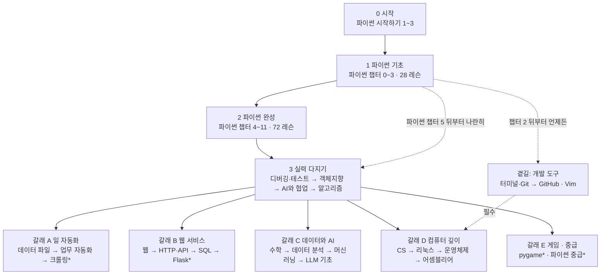

# 학습 로드맵 — 무엇을 어떤 순서로

교과서 21개를 어떤 순서로 배우면 좋은지, 그 근거와 함께 적은 문서예요. 허브 묶음 순서가 이 문서를 따라요.

## 지금 상태

- 11/8 Opus 가 문서로만 설계했어요.
- ✅ 허브 묶음 순서(6절 선택지 1)는 v2.42.1 에 반영했어요.
- ⏳ 화면에 더 보여 줄지(6절 선택지 2 · 3)는 사용자가 정할 일이에요(`TODO.md` 1-2).
- ✅ v2.46.0: 허브 맨 위에 「필수교양」(영어 단어장)이 생겼어요. 아래 단계별 길의 한 단계가 아니라, 어느 단계에 있든 나란히 매일 조금씩 하는 것이에요(사용자 결정 D27, `specs/vocab.md`).

왜 만들었나
- 사용자가 허브 묶음 순서의 까닭을 물었어요(11/8).
- 묶음 사이의 순서에는 적어 둔 근거가 없었어요. v2.40.0 에는 「묶음 안은 추천 순서」 만 있었어요.
- 사용자가 개발은 하지 말고 로드맵을 문서로만 짜 달라고 했어요.

## 1. 근거로 쓴 것 (기억이 아니라 데이터)

| 근거 | 어디서 | 뜻 |
|---|---|---|
| **필수** | 각 교과서 첫머리의 「먼저 꼭!」 칸(`book.js` 의 prereq) | 이게 없으면 첫 레슨부터 막혀요 |
| **추천 시점** | `courses/<id>/course.json` 의 `requires` | 「파이썬 챕터 n 의 만들어 보기 뒤부터」 |
| **참고 링크 수** | 교과서 본문 · 문제 안의 다른 교과서 링크(`../<코스>/`) 개수 | 많이 가리키는 코스를 먼저 배우면 편해요(없어도 진행은 돼요) |
| **설계 선수** | `specs/courses-python-next.md` 의 「대상 · 선수」 | 아직 안 만든 4개 코스의 선수 |

뽑은 결과(11/8 기준, 교과서 21개):

| 코스 | 레슨 | 필수(먼저 꼭) | 추천 시점 | 많이 가리키는 코스(링크 수) |
|---|---|---|---|---|
| 파이썬 | 100 | 시작하기 1~3(설치 · VS Code) | — | — |
| 터미널·Git | 20 | 시작하기(Git Bash) | 파이썬 챕터 2 뒤 | — |
| GitHub | 22 | **터미널·Git 레슨 6 · 16** | — | 터미널·Git 3 |
| Vim | 14 | 시작하기(gVim) | — | — |
| 리눅스 | 18 | CPU 가상화 켜기 | — | 터미널·Git 7 |
| SQL | 17 | 시작하기(DB Browser) | 파이썬 챕터 3 뒤 | — |
| 웹 | 34 | 시작하기(VS Code · Live Server) | 파이썬 챕터 2 뒤 | — |
| HTTP·API·SDK | 21 | 파이썬 + requests | — | 파이썬 13 |
| 알고리즘 | 36 | 파이썬 시작하기 | 파이썬 챕터 3 뒤 | — |
| 디버깅·테스트 | 18 | 파이썬 시작하기 · 가상 환경 | 파이썬 챕터 5 뒤 (v2.43.0) | 파이썬 24 · GitHub 5 |
| 객체지향·설계 | 17 | 파이썬 시작하기 · 가상 환경 | 파이썬 챕터 5 뒤 (v2.43.0) | 파이썬 31 |
| 데이터 파일 | 18 | 가상 환경 · openpyxl | — | 파이썬 38 · 데이터 분석 6 |
| 업무 자동화 | 18 | 가상 환경 · 패키지 넷 | — | 파이썬 65 · **데이터 파일 7** |
| 수학 | 45 | 시작하기 | — | — |
| 데이터 분석 | 18 | 파이썬 시작하기 · pandas | — | 파이썬 10 · **SQL 8** · 수학 5 |
| AI·머신러닝 | 16 | 파이썬 시작하기 · numpy 등 | — | LLM 7 · **수학 6** |
| LLM 기초 | 20 | 파이썬(리스트 · 딕셔너리 · 함수 · 클래스) · numpy | — | **수학 9** · 파이썬 8 |
| AI와 협업 | 23 | 파이썬 시작하기 · 가상 환경 | 디버깅 다음 (v2.43.0, 허브 「파이썬 실력 키우기」) | 파이썬 11 · **디버깅 8** |
| CS | 23 | 파이썬 시작하기 1~3 | — | 운영체제 9 · 어셈블리어 8(→ 더 깊이 갈 곳) |
| 운영체제 | 21 | **리눅스 UB1(우분투 연습장)** | — | 리눅스 1 |
| 어셈블리어 | 21 | **리눅스 UB1** · nasm | — | **운영체제 7** |
| *(설계)* 크롤링 | 17 | 파이썬 100 | — | HTTP·API H0~H5 |
| *(설계)* Flask | 18 | 파이썬 100 | — | 웹(W1~W4 · W11) · HTTP·API · SQL · CS C16 · C18 · 디버깅 · 객체지향 |
| *(설계)* pygame | 17 | 파이썬 100 | — | — |
| *(설계)* 중급 | 17 | 파이썬 100 | — | — |

알게 된 것:
- **정말로 막히는 선수(필수)는 셋뿐**이에요.
  - 파이썬 → 거의 모든 코스
  - 터미널·Git → GitHub
  - 리눅스 → 운영체제 · 어셈블리어
- 나머지는 「먼저 하면 편한」 관계예요. 예: SQL → 데이터 분석, 수학 → LLM · 머신러닝, 데이터 파일 → 업무 자동화, 디버깅 → AI와 협업.
- **CS 는 시작 조건이 가벼워요**(파이썬 시작하기만). 그런데 본문이 운영체제 · 어셈블리어를 「더 깊이」 로 가리켜요. 그래서 컴퓨터 깊이 갈래의 **입구**예요. 맨 끝일 까닭은 없어요.
- **터미널·Git · 웹은 파이썬 챕터 2 뒤부터** 할 수 있어요. 파이썬을 다 끝낼 때까지 기다릴 필요가 없어요.

## 2. 한 장 지도

`*` 는 설계만 된 코스예요. 점선은 「주 길과 나란히 언제든」 이에요.

## 3. 단계별 길

### 0단계 · 시작 (반나절)
- 파이썬 교과서 「🛠 시작하기」 1~3: 파이썬 설치 · VS Code 연결 · 첫 파일 실행.
- 근거: 거의 모든 교과서의 「먼저 꼭」 이 이것을 요구해요.

### 1단계 · 파이썬 기초 — 파이썬 챕터 0~3 (28 레슨: 번호 0~24 + 만들어 보기 B1~B3)
- 첫걸음 → 반복과 묶음 → 데이터 다루기.
- **곁길 열림**
  - 챕터 2(B2 숫자 맞히기 완성) 뒤: **터미널·Git** · **웹**(화면만)을 나란히 시작해도 돼요(course.json 추천 시점).
  - 챕터 3(B3 가계부) 뒤: **SQL** · **알고리즘**을 나란히 시작해도 돼요.
  - Vim 은 언제든(선수 없음).

### 2단계 · 파이썬 완성 — 파이썬 챕터 4~11 (72 레슨: 번호 25~89 + 만들어 보기 B4~B10)
- 더 큰 프로그램 → 마무리 → 실전 → 한 걸음 더 → 표준 라이브러리 더 → 실전 2 → 더 깊이 → 실전 3.
- **곁길**: 터미널·Git 을 마쳤으면 **GitHub**(필수 선수가 터미널·Git 레슨 6 · 16).
- 이 단계를 마치면 「파이썬으로 만들기」 코스들(파이썬 100 이 선수)이 열려요.

### 3단계 · 실력 다지기 — 갈래를 고르기 전에 넷

- **디버깅 · 객체지향은 파이썬 챕터 5(레슨 47) 뒤부터 2단계와 나란히 시작해도 돼요.** 두 교과서가 「복습」 으로 가리키는 파이썬 레슨은 거의 다 챕터 4 ~ 5(클래스 · 예외 · 테스트)예요. 챕터 8 ~ 11 은 한 번뿐이에요(11/8 파이썬 검토).
- 데이터 파일 · 업무 자동화는 챕터 8(csv · pathlib · 날짜) · 10 을 많이 가리켜서 파이썬을 끝까지 마친 뒤가 좋아요.

| 순서 | 코스 | 왜 이 자리 |
|---|---|---|
| 1 | 디버깅·테스트 (18) | 뒤 코스들이 가장 많이 가리켜요(AI와 협업 8 · Flask 설계). pytest · fixture 를 뒤에서 그냥 써요 |
| 2 | 객체지향·설계 (17) | Flask 설계가 O5 · O7 을 선수로 둬요. 파이썬 링크가 31개라 파이썬 직후가 자연스러워요 |
| 3 | AI와 협업 (23) | v2.43.0 에 「데이터와 AI」 에서 옮김. AI 원리가 아니라 **AI 도구로 일하는 법**이고, 디버깅을 8번 가리켜요. 모든 갈래에서 쓰는 공통 습관이라 갈래 앞에 둬요 |
| 4 | 알고리즘 (36) | 1단계부터 나란히 시작했으면 여기서 마무리. 코딩 테스트가 목표가 아니면 갈래 뒤로 미뤄도 돼요 |

### 4단계 · 갈래 (목표에 맞춰 하나부터, 여러 개 가능)

**갈래 A · 일 자동화** — 「회사 · 학교 일을 줄이고 싶다」
1. 데이터 파일 다루기 (18): JSON · 엑셀
2. 업무 자동화 (18): 데이터 파일을 7번 가리켜요
3. *(설계)* 크롤링 (17): HTTP·API H0~H5 를 먼저 보면 좋아요 → 갈래 B 의 HTTP·API 앞부분만 먼저

**갈래 B · 웹 서비스** — 「내 웹 서비스를 만들고 싶다」
1. 웹 (34): 화면 HTML · CSS · JS. 1단계부터 나란히 시작했으면 여기서 마무리
2. HTTP·API·SDK (21): 요청 · 응답 · FastAPI
3. SQL (17): 1단계부터 나란히 했으면 건너뜀
4. *(설계)* Flask (18): 위 셋 + CS C16 · C18(비밀번호 저장) + 디버깅 · 객체지향을 선수로 둬요. 그래서 이 갈래의 끝이에요

**갈래 C · 데이터와 AI** — 「데이터 분석 · AI 원리를 알고 싶다」
1. 수학 (45): LLM 9 · 머신러닝 6 · 데이터 5 번 가리켜요. 앞부분만 하고 넘어가도 돼요
2. 데이터 분석 (18): SQL 을 8번 가리켜요 → SQL 을 먼저(1단계 곁길)
3. AI·머신러닝 기초 (16)
4. LLM 기초 (20)

**갈래 D · 컴퓨터 깊이** — 「컴퓨터가 실제로 어떻게 도는지」
1. CS (23): 시작 조건이 가벼워서 **2단계 중에 시작해도 돼요**. 이 갈래의 입구
2. 리눅스 (18): 우분투 연습장(UB1)을 만들어요. 터미널·Git 을 7번 가리켜요 → 터미널·Git 다음
3. 운영체제 (21): **필수** 리눅스 UB1
4. 어셈블리어 (21): **필수** 리눅스 UB1, 운영체제를 7번 가리켜요 → 운영체제 다음

**갈래 E · 게임 · 더 단단한 파이썬**
- *(설계)* pygame (17): 파이썬 100 만 있으면 돼요. 동기 부여용으로 2단계 직후에 해도 좋아요
- *(설계)* 파이썬 중급 (17): 타입 검사 · 동시성 · 패키지 만들기. 디버깅 · 객체지향 다음이 좋아요(ruff 가 D5 버그를 잡는 이야기 등)

### 곁길 · 개발 도구 (언제든, 주 길과 나란히)
- 터미널·Git (20) → GitHub (22): GitHub 은 터미널·Git 이 **필수**
- Vim (14): 선수 없음. 리눅스 · 운영체제 전에 하면 우분투에서 편해요
- 리눅스는 갈래 D 의 2번이지만, 터미널·Git 을 마친 사람은 언제 해도 돼요

## 4. 목표별 빠른 길 (레슨 수는 11/8 의 `core/config.js` · 교과서 데이터 기준)

| 목표 | 길 | 레슨 합 |
|---|---|---|
| 프로그래밍 처음 · 일단 하나 써 보기 | 파이썬 챕터 0~3 → 터미널·Git → 웹(화면) | 28 + 20 + 34 = 82 |
| 일 자동화 | 파이썬 100 → 디버깅 → 데이터 파일 → 업무 자동화 | 100 + 18 + 18 + 18 = 154 |
| 웹 서비스 | 파이썬 100 → 웹 → HTTP·API → SQL → (Flask) | 100 + 34 + 21 + 17 (+18) = 172 (+18) |
| 데이터 · AI | 파이썬 100 → SQL → 수학 → 데이터 → 머신러닝 → LLM | 100 + 17 + 45 + 18 + 16 + 20 = 216 |
| 코딩 테스트 | 파이썬 챕터 0~3 → 알고리즘 → 파이썬 나머지 | 28 + 36 + 72 = 136 |
| 컴퓨터 깊이 | 파이썬 챕터 0~3 → CS → 터미널·Git → 리눅스 → 운영체제 → 어셈블리어 | 28 + 23 + 20 + 18 + 21 + 21 = 131 |

파이썬 챕터 0~3 은 28 레슨(시작 1 · 첫걸음 6 · 반복과 묶음 9 · 데이터 다루기 12), 나머지 챕터 4~11 은 72 레슨이에요.

## 5. 그때 허브 순서와 다른 점

설계할 때(v2.40.0 ~ v2.42.0)의 허브 순서: 🐍 처음 시작 → 🧰 개발 도구 → 💪 파이썬 실력 → 🛠 파이썬으로 만들기 → 🌐 웹과 서비스 → 📊 데이터와 AI → ⚙️ 컴퓨터 깊이

- v2.42.1 부터는 로드맵 순서예요: 🐍 처음 시작 → 💪 파이썬 실력 → 🛠 만들기 → 🌐 웹 → 📊 데이터와 AI → ⚙️ 컴퓨터 깊이 → 🧰 개발 도구(곁길).
- 아래 표의 「지금」 칸은 설계할 때의 허브예요.

| 그때 허브 | 로드맵 | 까닭 |
|---|---|---|
| 개발 도구가 2번째 묶음 | **곁길**(주 길과 나란히) | 파이썬 교과서는 터미널·Git 없이 시작해요. 필수로 막는 곳은 GitHub · 리눅스 쪽뿐이에요 |
| 컴퓨터 깊이가 맨 끝 · CS 도 맨 끝 | **갈래 D**, CS 는 2단계 중에 시작해도 됨 | CS 는 시작 조건이 가볍고 운영체제 · 어셈블리어의 입구예요 |
| 수학이 데이터와 AI 안 첫째 | 갈래 C 의 1번(앞부분만 해도 됨) | 그대로지만 「앞부분만」 을 알려 주면 좋아요(45 레슨이라 막힘) |
| SQL 이 웹과 서비스 안 | 1단계 곁길(챕터 3 뒤) + 갈래 B · C 둘 다에 | 데이터 분석이 SQL 을 8번 가리켜요 |
| 알고리즘이 파이썬 실력 안 | 1단계 곁길(챕터 3 뒤)부터 3단계까지 | course.json 추천 시점이 챕터 3 뒤예요 |
| Flask 는 웹과 서비스(설계) | 갈래 B 의 끝 | 선수가 가장 많아요(웹 · HTTP·API · SQL · CS · 디버깅 · 객체지향) |

## 6. 화면에 옮기는 선택지 (사용자가 정할 것 — 사이트 방향)

1번은 v2.42.1 에 만들었어요. 2 · 3번은 사용자가 고르면 그때 만들어요.

1. **허브 묶음 순서만 바꾸기**: 처음 시작 → 파이썬 실력 → 갈래 넷(만들기 · 웹 · 데이터 · 깊이) → 개발 도구를 「언제든」 표시로. 가장 작은 변경.
   - ✅ **v2.42.1 에 반영**(11/8 사용자 선택, D24)
   - 리눅스는 컴퓨터 깊이의 2번으로, 묶음 설명 글에 「갈래 · 곁길 · 언제부터」.
2. **허브 맨 위에 「추천 길」 한 줄 + 카드마다 「먼저: ○○」 표시**: 묶음은 그대로 두고, 필수 선수(GitHub ← 터미널·Git, 운영체제 · 어셈블리어 ← 리눅스)와 추천 시점(파이썬 챕터 2 · 3 뒤)을 카드에 적어요.
3. **허브에 「로드맵」 화면 하나 더**: 2절 지도를 그림으로, 단계마다 코스 카드와 읽은 레슨 수. 다른 화면으로 가니 돌아오는 버튼 필요.

추천: **2번** (`TODO.md` 1-2 의 ① 과 같은 안)
- 지금 분류를 깨지 않고, 사용자가 「무엇을 먼저」 를 카드에서 바로 봐요.
- 근거(필수 · 추천 시점)는 이미 데이터에 있어서 손으로 적을 게 적어요.

## 7. 이 문서를 고칠 때

- 새 코스를 만들거나 「먼저 꼭」 · course.json `requires` 를 바꾸면 1절 표와 3절 길을 같이 고쳐요.
- 1절 숫자는 데이터에서 다시 뽑아요(LESSON.md R10 — 기억으로 쓰지 않기).
